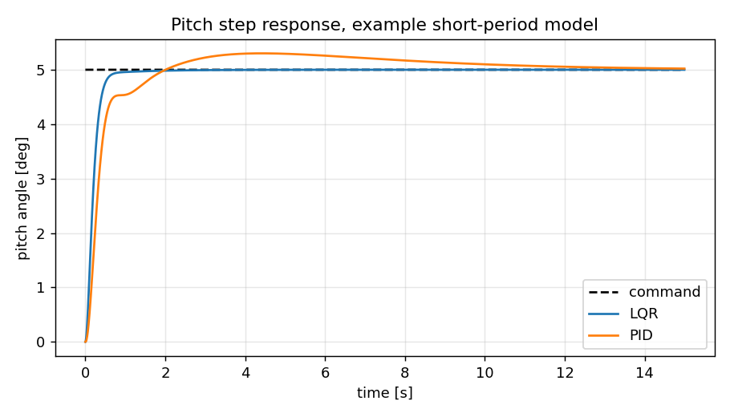

# shortperiod-gnc

Small Python toolkit for aircraft short-period dynamics and pitch autopilot design.
It is a new project (November 2026), early stage, and made for learning and for quick
control-design experiments. It has no users or dependents yet.

What it does:

- Linear short-period longitudinal model with states `[alpha, q, theta]` and elevator input.
- Natural frequency and damping of the short-period mode.
- LQR state-feedback design with a pitch-reference prefilter.
- PID pitch loop with a filtered derivative.
- Step-response metrics: rise time, overshoot, settling time.
- A command-line demo that compares LQR and PID and saves a plot.

The example coefficients are illustrative, not a specific real aircraft.

**Educational simulation only.** This is a linear, single-mode model with no actuator limits,
sensor noise, delays or nonlinear effects. It is not a flight-ready controller and must not be used to fly anything.

## Use

```
pip install numpy scipy matplotlib
python shortperiod_gnc.py --theta-deg 5 --plot step_response.png
python -m unittest -v
```

```python
import numpy as np
from shortperiod_gnc import example_aircraft, closed_loop_lqr, simulate, step_metrics

m = example_aircraft()
A, B, C, D, K = closed_loop_lqr(m)
t = np.arange(0, 10, 0.005)
y, _ = simulate(A, B, C, D, t, np.full_like(t, 0.1))   # 0.1 rad pitch step
print(step_metrics(t, y, final=0.1))
```

## Example output



## Tests

Six unit tests cover the model poles, the LQR solver (checked against a scalar case with a known answer),
closed-loop stability and tracking for LQR and PID, and the step metrics (checked against a first-order system).

## Disclosure

This code was written by an AI assistant working on the repo owner's behalf, not hand-written by the owner, and then tested with the unit tests above. The repo was created in November 2026 and has a single initial upload.

## License

MIT
